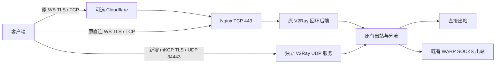

# 访客网络代理慢速排查与 mKCP TLS 优化

日期：2026-10-30，时区：Asia/Shanghai。本文归档一次同一 VPS 在公司访客 Wi-Fi 下代理很慢、手机热点下较好的排查。网络名称、实际地址、账号和密钥已脱敏。

**结论：底层丢包尚未消除。优化将代理的外层传输从 WebSocket／TCP 改为 mKCP／UDP，并保留 TLS 1.3 和正常证书校验，使该丢包链路上的实际代理速度明显改善。** 具体在哪个网络设备或运营商区段丢包，尚未确定；没有足够证据认定公司主动限速。

## 1 问题和环境

症状包括网页加载慢、代理握手超时、聊天应用难以持续使用。旧节点此前可用，近期没有主动修改域名和 CDN 配置；其他人使用不同节点可以正常联网，因此不能直接推断整个公司网络不可用。

| 项目 | 当时环境 |
| --- | --- |
| VPS | 美国东部，1 vCPU，约 1 GiB RAM，CentOS 7，Linux 3.10 |
| 原服务器核心 | V2Ray 4.45.0，Go 1.18.1；本次复用原二进制 |
| 原入口 | VMess AEAD＋WebSocket＋TLS，可经 Cloudflare 或直连 Nginx |
| Mac 客户端 | V2rayU 5.0.3，Xray 26.1.18 |
| 最终新增入口 | VMess AES-128-GCM＋mKCP＋TLS 1.3，UDP 34443 |
| 测试限制 | 同一台客户端、同一 VPS；公开测速对象；主要为短时测试，没有长期 SLA 测量 |

上述版本是历史复现环境，不是当前部署版本推荐。CentOS Linux 7 已于 2024-06-30 结束维护，操作系统和核心的更新应作为独立维护任务安排。[CentOS 官方说明](https://centos.org/centos-linux/)



新入口复用原有用户认证与出站策略，不依赖 Nginx 转发 UDP。它没有把 WebSocket 改成 UDP；它是另一条独立传输入口。

## 2 排查证据

### 局域网和国内下载

早期测量中，到 Wi-Fi 网关平均约 7 ms、未见丢包，国内小网页约 0.14–0.18 秒。后续补测国内 HTTPS 文件：1 MiB 在约 **0.266 秒**内下载完成，平均约 **3.94 MB/s**。这证明当时 Wi-Fi 能承载较快传输，但不能据此证明任意时段、任意目的地都没有问题。

### SSH 和代理都慢

网络稳定后重复测量，SSH 在 17.017 秒内收到 278,528 字节，约 16 KiB/s；原代理在约 15 秒内收到 327,680 字节，约 21 KiB/s。SSH 不经过 VMess 或 Nginx，说明慢速现象不局限于代理配置。

服务器本地代理链此前测得约 164–190 Mbps，服务器直接出站也明显快于公司网络下的端到端传输；这些测量不构成 VPS 所有时段的性能保证。历史 dmesg 中的 OOM、conntrack 报错不能直接当作本次慢速的实时原因。

### TCP 接收缺口与重传

对一个稳定网络下的 SSH 下载连接，在服务器侧只记录报文头和 TCP 元数据：

| 观察项 | 结果 |
| --- | ---: |
| 采样记录 | 731 条 |
| 客户端 ACK 记录 | 383 条 |
| 含 SACK 的记录 | 113 条 |
| 不同累计 ACK 缺口 | 48 个 |
| 重复发送序列区间字节 | 20,670 字节 |
| 客户端零接收窗口 | 0 次 |
| DSACK 记录 | 0 次 |
| 能关联重传和 ACK 恢复的事件 | 13 个 |

可关联事件通常在重传后约一个完整 RTT（约 243–312 ms）才得到 ACK 恢复，符合缺失报文经重传后补齐的表现。接收窗口保持开放；观测到的最小窗口字段为 1769，窗口缩放为 6，对应约 113 KiB。

这些计数支持链路数据缺失、重传及 TCP 拥塞退让的判断。**SACK 记录占比不是物理丢包率，重复序列字节占比也不能直接当作链路丢包率。** 单侧观察不能精确定位故障设备，也不能完全排除中间设备处理或严重重排。

### UDP 回包对照

在同一 VPS 临时开启自动结束的 UDP 回显诊断。客户端对 UDP 443、34443 各发送 1000 个 1300 字节数据报，每条流约 2.08 Mb/s，同时发送约 5 秒，随后继续接收约 3 秒。

| UDP 端口 | 客户端发送 | 服务端应用收到 | 客户端收到回包 | 本轮缺失回包 |
| --- | ---: | ---: | ---: | ---: |
| 443 | 1000 | 1000 | 969 | 3.1% |
| 34443 | 1000 | 1000 | 913 | 8.7% |

服务端收齐请求、客户端未收齐回包，把本轮问题进一步缩小到**服务器回到客户端的回包方向**，包括服务器网络栈、虚拟网络、运营商路径、企业出口和接入网络等可能区段。此结果不是长期丢包率，也不证明某个端口必然优于另一个端口。

双向 traceroute 显示去程、回程经过不同网络。路由不对称本身是常见现象；路由器不回复探测包也不等于转发丢包，因此没有据此认定故障跳点。公开归档不包含实际网络地址和原始路由记录。

## 3 对照结果

以下速度采用十进制 KB/s，1 MiB＝1,048,576 字节；包括建连、握手和首字节等待，属于小文件端到端平均速度，不代表链路峰值带宽。[脱敏测量 CSV](measurements.csv)保留对应字节数和耗时。

### 同一公司网络上的交叉测试

同一 VPS、同一 1 MiB 公开测试对象，按顺序测原 TCP、独立 UDP TLS、独立 UDP TLS 重复。没有同时运行两条大流来人为争抢带宽。

| 入口 | 完成情况 | 耗时 | 收到字节 | 平均速度 |
| --- | --- | ---: | ---: | ---: |
| 原 WS TLS／TCP | 15 秒达到测试上限，文件未完成 | 15.002 s | 711,887 | 47.45 KB/s |
| 新 mKCP TLS，隔离客户端 | 完整下载 | 1.161 s | 1,048,576 | 902.78 KB/s |
| 新 mKCP TLS，隔离客户端重复 | 完整下载 | 1.195 s | 1,048,576 | 877.45 KB/s |

### 切换到 V2rayU 正式节点后

| 检查 | 结果 |
| --- | --- |
| 网页连通 | HTTP 200，0.879 s |
| OpenAI models，无 API 凭据 | HTTP 401，1.061 s；这是预期的未认证响应，仅验证连通 |
| 1 MiB 下载 1 | HTTP 200，1.836 s，571.10 KB/s |
| 1 MiB 下载 2 | HTTP 200，4.272 s，245.43 KB/s |
| ChatGPT 域名连通检查 | `/cdn-cgi/trace` HTTP 200，1.015 s；不是完整聊天生成或账户登录测试 |

正式客户端仍存在波动。多轮原 TCP 测量约 19–47 KB/s，新节点正式客户端约 245–571 KB/s；“约 5–30 倍”是这批短时样本的范围，不是通用性能承诺。手机热点早前的同一原站 IPv4 下载约 369 KB/s，进一步说明表现与网络路径有关。

曾有一组交叉测试碰到临时服务器自动退出，后半段因此超时。该组被排除；上表来自服务存活并完成验证的后续测量。未使用这类进程退出超时来推断网络故障。

## 4 实际优化内容

1. 新增独立服务 `v2ray-udp.service`，复用 `/usr/local/bin/v2ray`，配置位于 `/etc/v2ray-udp/config.json`，监听 UDP 34443。
2. 外层传输使用 mKCP，`congestion=false`。它避免原 TCP 在该链路上频繁收缩发送窗口造成的严重降速，代价是更积极发送和更多重传流量。它没有修复底层丢包。
3. 保留 VMess AEAD，客户端明确选择 `aes-128-gcm`；启用 TLS，服务器只允许 TLS 1.3。客户端使用正常 CA／IP 身份校验，`allowInsecure=false`，没有跳过证书验证。
4. 复用既有可自动续期的可信 IP 证书。mKCP Seed 必须在两端一致；Seed 是传输混淆参数，不能取代用户认证和 TLS。[V2Fly mKCP 文档](https://www.v2fly.org/config/transport/mkcp.html)
5. 服务器独立配置沿用原有出站、DNS、策略和路由对象；已有经 WARP 的分流继续使用既有 SOCKS 出站。原 TCP 服务和 Nginx 不承担新 UDP 入口的转发。
6. Mac 新增并启用独立的 UDP TLS 节点，原域名节点、原直连 WS TLS 节点均保留。

| mKCP 参数 | 新服务器 | Mac 客户端实际生成 |
| --- | ---: | ---: |
| mtu | 1350 | 1350 |
| tti，毫秒 | 20 | 50 |
| uplinkCapacity，MB/s | 1 | 5 |
| downlinkCapacity，MB/s | 1 | 20 |
| congestion | false | false |
| readBufferSize，MB | 1 | 2 |
| writeBufferSize，MB | 1 | 2 |
| header | none | none |
| seed | 私有，两端一致 | 私有，两端一致 |

容量是 mKCP 逻辑连接的配置，不是整台 VPS 的全局流量限额。此次没有穷举参数来寻找理论最大速度。

## 5 安全和证书生命周期

- 新服务以专用非登录账户 `v2ray-udp` 运行。实际验证 `CapEff=0`、`NoNewPrivs=1`；最终检查的常驻内存约 23 MiB。
- 配置目录权限 0750，配置文件 0640；运行时证书目录 0700，证书和私钥副本 0600。原有证书源文件的权限没有放宽。
- systemd 219 的 `PermissionsStartOnly=true` 让启动前证书复制由 root 执行。模板的能力边界包含该复制步骤需要的 `CAP_CHOWN`、`CAP_DAC_OVERRIDE`；实际网络服务进程是非 root，生效能力为零。
- 既有证书续期服务增加一个 `ExecStartPost` 钩子。证书或私钥内容确有变化且新 UDP 服务处于运行状态时，才重启该 UDP 服务并加载新副本；内容一致不重启。
- 验证过内容一致时钩子不重启服务。真正发生新证书签发后的联动仍需在后续续期时观察，不能把本轮检查写成已完成真实续期演练。
- 错误证书名称的负向测试触发 `x509` 身份校验失败；正向请求通过。不能仅凭负向 curl 超时就断言证书校验有效，判断还包含核心的证书错误日志。

可信 IP 证书通常有效期较短，续期联动是这套配置可持续使用的重要条件。不要在续期后依赖旧叶子证书指纹，也不要通过关闭验证来处理证书错误。

## 6 前期修复与未证实的尝试

本轮性能方案是在此前基线上新增 UDP 服务。此前已完成的可用性／安全修复包括：原 Nginx 限制 TLS 版本、WebSocket 转发缓冲与超时处理、后端绑定回环、配置／私钥权限修正，以及给直连 IP 提供可信证书。它们不能单独解释或消除后续测得的慢速。

原域名入口的 Cloudflare Origin CA 证书不适合作为普通客户端默认信任的公网证书。前期直连节点因证书校验失败不可用，修正为可信 IP 证书后能够连接；**能连接和持续下载快是两个不同验证目标**。

曾测试较小 MTU、不同 TLS 指纹、CDN 地址和 Mux 等方案，没有找到稳定解决本次慢速的配置。最终没有保留这些临时测试的 MTU、Mux 修改，没有把本轮描述为 BBR 或内核升级，也没有把关闭证书验证作为提速方案。

## 7 模板和复核步骤

模板位于 [templates](templates/)。其中的 `198.51.100.10` 是文档示例地址，UUID 和 Seed 均为占位符。模板用于说明归档结构，不是一键安装器，也不是可直接导入的私人节点。

服务端 JSON 是**入站传输片段**。要构成独立配置，还必须合并目标服务器实际使用的 `outbounds`、`routing`，以及需要的 `dns`、`policy`。不要用这个片段覆盖原运行配置。实际用户、证书路径、续期服务名和权限必须按环境填写。

建议的复核顺序：

1. 备份当前服务配置和客户端数据库，确认所有占位符已替换。
2. 用当前服务二进制执行配置检查；验证服务账户能读配置及证书副本。
3. 先启动独立入口，检查原 Nginx、原 V2Ray 仍正常，确认 UDP 监听正确。
4. 使用隔离客户端测试正向请求和错误证书名称的负向用例。
5. 再新增客户端节点，核对生成的运行 JSON 是否实际包含 Seed、TLS、正确证书身份和加密参数。
6. 同一网络下顺序比较原节点与新节点，记录完整字节数、首字节、总耗时和超时，不把部分下载视为完成。
7. 正式节点验证后再启用开机启动，确认续期钩子、非 root 运行和回退入口。

例如，已手动选定待测节点后，经本地 HTTP 代理测量公开的 1 MiB 对象：

```sh
curl --http1.1 --proxy http://127.0.0.1:1087 \
  --connect-timeout 7 --max-time 15 --silent --show-error \
  --output /dev/null \
  --write-out '%{http_code} %{size_download} %{time_starttransfer} %{time_total} %{speed_download}\n' \
  'https://speed.cloudflare.com/__down?bytes=1048576'
```

此命令不会自动切换节点或改变系统代理设置。不同平台的本地代理端口可能不同。

## 8 回退

先在客户端切回保留的原节点，确认可以连接，再停用新增 UDP 服务：

```sh
sudo systemctl disable --now v2ray-udp.service
```

该操作针对新增服务。原 TCP 服务与 Nginx 继续使用原配置。需要彻底卸载时，应核对并删除新增 unit、专用配置、续期 drop-in 和证书复制辅助脚本，重新加载 systemd；不要删除共用证书源、原服务文件或原用户配置。

## 9 手机和其他设备

服务器入口不绑定某台 Mac。其他设备需要支持 **VMess＋mKCP＋TLS**，完整保存 Seed、UDP 端口、服务器证书身份和正常证书校验。

本次只在 Mac 实测通过。v2rayNG 的 KCP／FinalMask 配置生成存在版本差异，不能保证普通分享链接在任意版本都保留正确参数；Shadowrocket 的公开说明确认包含 KCP，但这套完整组合仍需在目标版本实测。不要为适配手机而关闭 TLS 校验或覆盖已经可用的旧节点。

- [v2rayNG 配置结构](https://github.com/2dust/v2rayNG/blob/master/V2rayNG/app/src/main/java/com/v2ray/ang/dto/V2rayConfig.kt)
- [v2rayNG KCP 兼容修复讨论](https://github.com/2dust/v2rayNG/pull/6062)
- [Shadowrocket 官方更新记录](https://apps.apple.com/us/app/shadowrocket/id932747118)

## 10 归档边界与资料

公开归档只包含脱敏模板、选定测量和汇总。实际公网／内网地址、代理域名、UUID、Seed、账户口令、私钥、完整配置数据库、节点分享链接、截图和原始抓包均未上传。可运行的私人备份仍保存在原本机及服务器的受限目录。

测量记录是本次环境的观察值，不是推荐所有网络都更换为 mKCP。mKCP 通常更耗流量，需要可用 UDP；稳定网络上 WS／TCP 也可能有良好表现。

- [V2Fly mKCP 参数及流量权衡](https://www.v2fly.org/config/transport/mkcp.html)
- [服务器 V2Ray 4.45.0 的 KCP TLS 客户端封装](https://github.com/v2fly/v2ray-core/blob/v4.45.0/transport/internet/kcp/dialer.go)
- [服务器 V2Ray 4.45.0 的 KCP TLS 监听实现](https://github.com/v2fly/v2ray-core/blob/v4.45.0/transport/internet/kcp/listener.go)
- [本轮 Mac Xray 版本的 KCP TLS 实现](https://github.com/XTLS/Xray-core/blob/7ff06f6/transport/internet/kcp/dialer.go)

